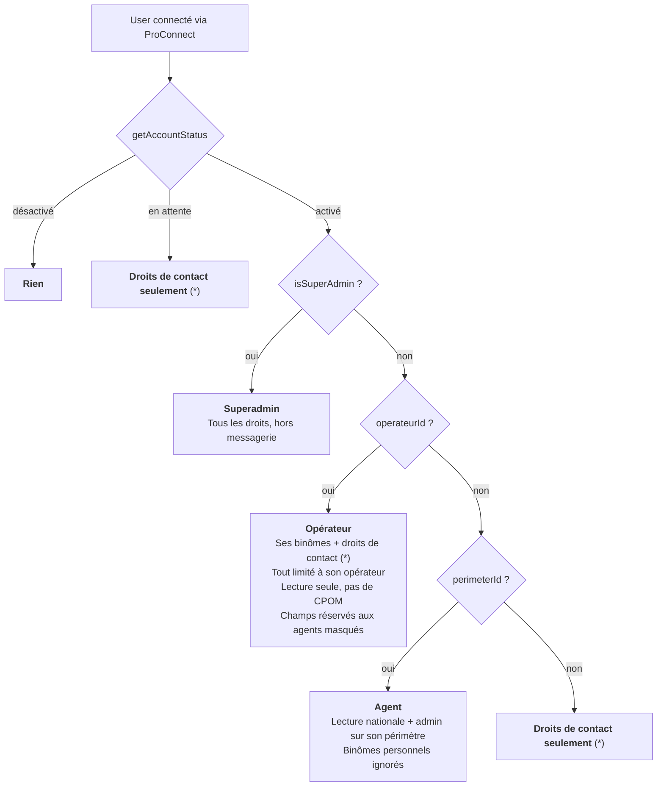

# Rôles et périmètres géographiques

Un user a accès à Bhasile si son compte est **activé**. Ses droits viennent de son **périmètre** s'il est agent, de ses **binômes** s'il est opérateur.

## Modèle

| Table / colonne                     | Rôle                                                                                                                          |
| ----------------------------------- | ----------------------------------------------------------------------------------------------------------------------------- |
| `Perimeter`                         | Service nommé (« DDETS Finistère », « SGAR Bretagne ») sur une zone `NATIONAL`, `REGION` ou `DEPARTEMENT`. Nom unique.        |
| `User.perimeterId`                  | Le périmètre d'un agent. Un seul par agent, partagé entre plusieurs agents.                                                   |
| `Grant`                             | Binôme personnel `rôle × zone` d'un user opérateur : `role` (`LECTEUR` < `EDITEUR` < `ADMIN`), `scope`, cible selon le scope. |
| `User.operateurId`                  | Renseigné = user opérateur.                                                                                                   |
| `User.isActivated`, `deactivatedAt` | État du compte, lu par `getAccountStatus` seulement.                                                                          |
| `User.isSuperAdmin`                 | Équipe Bhasile.                                                                                                               |

Plusieurs périmètres peuvent couvrir la même zone : seul le nom les distingue.

## Qui a quels droits

(\*) Seulement si `CONTACT_ACCESS_ENABLED=true`.

- **Agent** = périmètre renseigné sans opérateur (`isAgentUser`). Le superadmin compte comme agent (il voit tous les champs). Ses droits sont calculés à chaque session (`getPerimeterGrants`), jamais stockés : changer le périmètre d'un agent change ses droits.
- **Activation** : non activé = aucun droit stocké. Désactiver ne supprime rien (périmètre, binômes, historique) ; la date reste visible. Réactiver remet `deactivatedAt` à vide.
- **Droits de contact** : un user non-agent qui figure comme contact (même email, sans tenir compte de la casse) dans la version affichée d'une structure lit cette structure. Calculés à chaque session, jamais stockés. Exception provisoire, à confirmer avec les PO : ils ne demandent pas d'activation ; un compte désactivé les perd.
- **Superadmin** : `manage all`, mais hors messagerie : ni message, ni fichier, ni accusé de lecture (`canParticipateInTarification`).
- **Champs réservés aux agents** : masqués pour un non-agent (`hideAgentOnlyFields`) : notes, contrôles, évaluations, EIG, anomalies justifiées, CPOM.
- **Une seule source** : la session (`getPermissionsFromSession`) porte `isAgent`, `isSuperAdmin` et les binômes ; le code les lit via `lib/casl`. Sans binôme ni superadmin : `/acces-en-attente`, et 401 sur les routes d'API ProConnect.
- **Emails** : comparés sans tenir compte de la casse, écrits en minuscules (`normalizeEmail`).

## Ce que couvre un binôme

Les binômes s'additionnent, aucun ne restreint : sur une structure, le rôle le plus fort qui la couvre s'applique.

| Rôle                | Lecture                              | Écriture                             |
| ------------------- | ------------------------------------ | ------------------------------------ |
| `LECTEUR`           | Les structures et CPOM de cette zone | Rien                                 |
| `EDITEUR` / `ADMIN` | Les structures et CPOM de cette zone | Les structures et CPOM de cette zone |

- **Structures** : national = toutes ; région ou département = celles dont le département de rattachement est couvert ; structure = celle-là.
- **CPOM** : national = tous ; région ou département = ceux dont au moins un département est couvert, plus les CPOM régionaux de la région ; structure = ceux liés à cette structure. Un CPOM régional n'a pas de ligne `CpomDepartement` : `getCpomDepartements` (`cpoms/cpom.util.ts`) déduit ses départements de `regionId`.
- **Opérateurs** : un agent éditeur modifie tous les opérateurs ; un user opérateur ne modifie rien. Lecture non filtrée.
- **Tarification** : droit d'édition sur la structure, hors binômes nationaux (voir [Messagerie](messagerie.md)). Un agent national n'y a pas accès.
- **User opérateur** : tout est en plus restreint à son opérateur.

Lecture filtrée : liste, carte et fiche des structures, statistiques et cartographie (exports et RMU compris), liste et fiche des CPOM. Une fiche hors périmètre renvoie une 404. Exception : la sélection de structure du formulaire opérateur (mot de passe) reste non filtrée (`getFullStructuresForOperateur`). Le tableau de bord est filtré sur l'écriture.

Une seule définition de la couverture (`getStructureConditions` / `getCpomConditions` dans `casl/rules.ts`) sert à la lecture et à l'écriture ; les filtres Prisma en sont tirés par `accessibleBy`. Le code ne compare jamais les rôles entre eux : tout droit donné à un rôle l'est aussi aux rôles supérieurs.

## Choix et raisons

- **Périmètre ≠ binôme** : un périmètre est partagé par plusieurs agents et porte un nom métier ; un binôme est personnel. Une clé `User.perimeterId` garantit un seul périmètre par agent, ce qu'une ligne `Grant` ne garantirait pas.
- **Statut déduit des rattachements** : agent = périmètre, opérateur = `operateurId`. Plus de `isAgent` qui pourrait contredire le périmètre et faire fuiter des champs réservés.
- **Email patterns abandonnés** : un pattern donnait des droits à tout un domaine, y compris aux agents retirés.
- **`isActivated` + `deactivatedAt`** : distingue « jamais activé » (écran de demande) de « désactivé » (affiché comme tel).
- **`scope` explicite** : un binôme ou un périmètre sans cible ne donne rien, jamais tout.
- **Région stockée comme région** : une structure qui arrive en AURA entre dans les droits AURA.
- **Suppressions** : supprimer une zone ou une structure supprime ses binômes (`Cascade`) ; une zone ou un périmètre utilisés ne se suppriment pas (`Restrict`), un opérateur qui a des users non plus.

## Points d'attention

- **CPOM chargé sans ses champs de périmètre** : la règle CPOM lit `departements`, `structures`, `granularity` et `regionId` (`cpomScopeSelect`). Sans l'un d'eux, l'accès est refusé en silence.
- **Pas de contrainte en base** sur `Grant` ni sur `User` (périmètre et opérateur à la fois) : la cohérence est vérifiée par le service et par le one-off de reprise.
- **Maisons mères et filiales** (`Operateur.parentId`) : non géré. **Un user sur deux opérateurs** : exclu.
- **Non filtré en lecture** : fiche opérateur, fichiers (`/api/files`, ouverts à toute session), pages de transformation, moyenne départementale d'activité, vues `reporting` / Metabase.
- **`ADMIN` = `EDITEUR`** tant que la gestion des accès n'existe pas.

## Avant d'activer les contacts

`CONTACT_ACCESS_ENABLED=true` ouvre l'application à des non-agents. Avant, fermer ce qui reste ouvert à toute session : fichiers, fiche et liste des opérateurs, pages de transformation, statistiques (le RMU suit le département), pages et menu réservés aux agents.

## Reprise et mise en prod

`yarn one-off 20261104-reset-agents <fichier.csv> [--dry-run]` lit l'export Tally sur le bucket (colonnes et libellés de niveau dans `AGENTS_DOCUMENT_COLUMNS` / `AGENTS_DOCUMENT_LEVELS`) :

- arrêt avant écriture sur une adresse ou un rôle en double, une zone introuvable, un doublon de casse en base ou un user opérateur dans le document ;
- périmètres upsertés par nom, agents du document créés ou rattachés puis activés, superadmins activés, agents activés absents du document désactivés, emails passés en minuscules ;
- le dry-run classe les agents (nouveau, même périmètre, droits différents avec avant / après), liste les désactivés avec leurs droits et leur dernière connexion, et met les nationaux absents en avertissement.

Mise en prod du basculement : lancer le one-off sur la version précédente (dry-run puis réel), conserver sa sortie (seule trace des anciens binômes), puis déployer. La migration supprime les binômes des agents, `EmailPattern`, `User.emailPatternId` et `User.isAgent`.

## Reste à faire

1. **Gestion des accès** :
   - écran de demande d'accès après ProConnect ;
   - création d'accès par les agents et par les opérateurs ;
   - API de gestion des binômes : un seul propriétaire, cible conforme au `scope`, hiérarchie stricte, refus d'un binôme déjà couvert par un droit égal ou supérieur sur une zone englobante (écriture Bretagne ⇒ pas d'écriture Finistère) ;
   - un admin ajoute ou retire un binôme dont la cible est dans son périmètre d'admin ; un admin opérateur ne gère que les users de son opérateur ;
   - désactivation par un admin qui couvre **tous** les binômes du user (inclusion complète) ; pas de blocage de l'auto-déclassement d'un admin national ;
   - affichage de la désactivation dans la messagerie.
2. **Ouverture aux opérateurs** :
   - authentification via ProConnect ;
   - fiche opérateur (#1742), CPOM liés à leurs structures, statistiques filtrées sur `operateurId` sans RMU ;
   - écriture par leurs binômes éditeur / admin, restreinte à leur opérateur, selon la matrice validée par le métier ;
   - Metabase fermé aux opérateurs.
