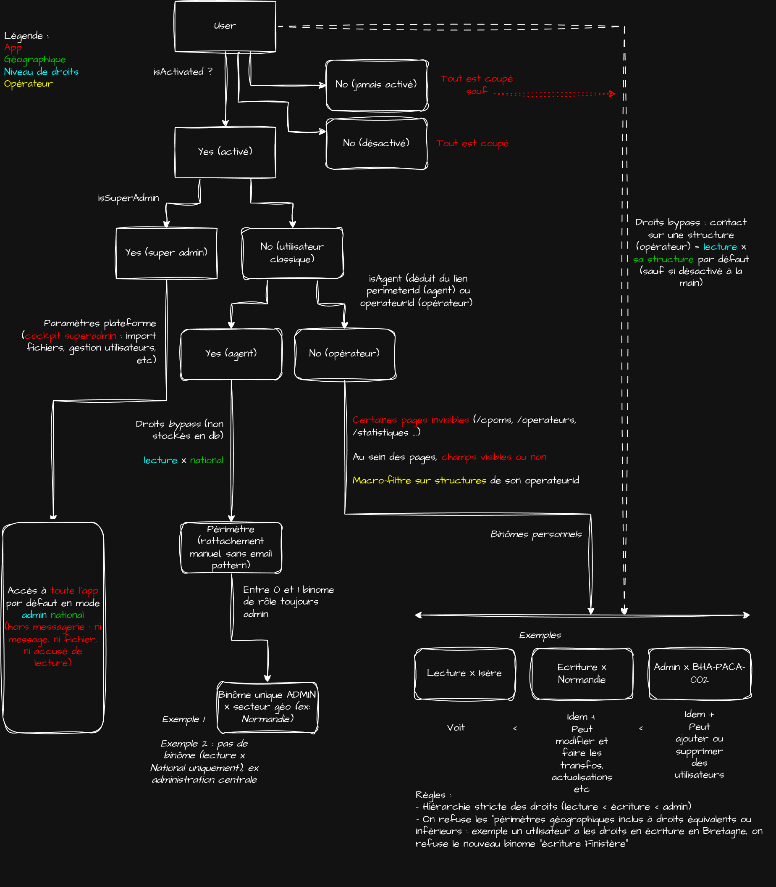

# Rôles et périmètres géographiques

Un user a accès à Bhasile si son compte est **activé**. Ses droits viennent de son **périmètre** s'il est agent, de ses **binômes** s'il est opérateur.

## Modèle

### Tables

| Table / colonne                     | Rôle                                                                                                                          |
| ----------------------------------- | ----------------------------------------------------------------------------------------------------------------------------- |
| `Perimeter`                         | Service nommé (« DDETS Finistère », « SGAR Bretagne ») sur une zone `NATIONAL`, `REGION` ou `DEPARTEMENT`. Nom unique.        |
| `User.perimeterId`                  | Le périmètre d'un agent. Un seul par agent, partagé entre plusieurs agents.                                                   |
| `Grant`                             | Binôme personnel `rôle × zone` d'un user opérateur : `role` (`LECTEUR` < `EDITEUR` < `ADMIN`), `scope`, cible selon le scope. |
| `User.operateurId`                  | Renseigné = user opérateur.                                                                                                   |
| `User.isActivated`, `deactivatedAt` | État du compte, lu par `getAccountStatus` seulement.                                                                          |
| `User.isSuperAdmin`                 | Équipe Bhasile.                                                                                                               |

Plusieurs périmètres peuvent couvrir la même zone.

### Qui a quels droits

- **Désactivé** : rien.
- **En attente** : droits de contact seulement (\*).
- **Superadmin** : tous les droits, hors messagerie (ni message, ni fichier, ni accusé de lecture).
- **Agent** : rattaché obligatoirement à un unique périmètre, dont il tire ses droits : lecture nationale + admin sur la zone du périmètre. Un périmètre national ne donne que la lecture : aucun agent n'écrit au niveau national, seul le superadmin a tous les droits.
- **Opérateur** : binômes « rôle × zone » attribués un à un, limités à son opérateur, plus ses droits de contact (\*). Aujourd'hui en lecture seule, sans CPOM ; certains champs lui sont masqués.
- **Activé sans périmètre ni opérateur** : droits de contact seulement (\*).

(\*) Droits de contact : un user non-agent qui figure comme contact (même email) dans la version affichée d'une structure lit cette structure, sans validation préalable. Seulement si `CONTACT_ACCESS_ENABLED=true`.

À noter pour les **emails** : users et contacts écrits sans espaces et en minuscules (`normalizeEmail`, `contactApiSchema`), puis comparés tels quels.

### Ce que couvre un binôme

Les droits d'un agent sont deux binômes calculés à partir de son périmètre ; ceux d'un opérateur sont stockés. Les binômes s'additionnent, aucun ne restreint : sur une structure, le rôle le plus fort qui la couvre s'applique.

Trois rôles :

- **Lecteur** : voit ;
- **Éditeur** : droits Lecteur + renseigne les fiches ;
- **Admin** : droits Éditeur + gère les accès.

Zones :

- **Structures** : national = toutes ; région ou département = celles dont le département administratif est dans la zone ; structure = celle-là.
- **CPOM** : national = tous ; région ou département = ceux dont au moins un département est dans la zone, plus les CPOM régionaux de la région ; structure = ceux liés à cette structure.
- **Tarification** : droit d'édition sur la structure, binômes nationaux exclus (voir [Messagerie](messagerie.md)).
- **Opérateur** : tout est en plus restreint à son `operateurId`.

Une fiche hors périmètre renvoie une 404.

## Choix et raisons

- **Périmètre ≠ binôme** : un périmètre (agents) est partagé par plusieurs agents et porte un nom métier ; un binôme (opérateur) est personnel et cumulable.
- **Statut déduit des rattachements** : agent = périmètre, opérateur = `operateurId`. Pas de `isAgent` qui pourrait contredire le périmètre.
- **Email patterns abandonnés** : par simplicité, pas de rattachement automatique par domaine d'email.
- **`isActivated` + `deactivatedAt`** : distingue « jamais activé » (écran de demande) de « désactivé » (affiché comme tel).
- **`scope` explicite** : un binôme ou un périmètre sans cible ne donne rien, jamais tout.
- **Région distincte du département** : couvrir une région revient à couvrir ses départements, mais le métier distingue les deux niveaux : un binôme régional couvre aussi les CPOM régionaux, et la messagerie sépare DREETS et DDETS (signature des messages, notifications réservées aux périmètres départementaux).
- **Suppressions** : supprimer une zone ou une structure supprime ses binômes (`Cascade`) ; une zone ou un périmètre utilisés ne se suppriment pas (`Restrict`), un opérateur qui a des users non plus.

## Avant d'activer les contacts

`CONTACT_ACCESS_ENABLED=true` ouvre l'application à des non-agents, sans validation préalable. Ouverture prévue après #1742, qui limite ce qu'un non-agent voit sur la fiche structure. Avant, fermer aussi ce qui reste ouvert à toute session : fichiers, fiche et liste des opérateurs, pages de transformation, statistiques (le RMU suit le département), pages et menu réservés aux agents.

## Reprise et mise en prod

Mise en prod du basculement :

1. sur #1773, lancer `20261104-reset-agents` (dry-run puis réel) et conserver sa sortie, seule trace des anciens binômes ;
2. déployer #1774 : la migration supprime `EmailPattern`, `User.emailPatternId` et `User.isAgent` ;
3. lancer `yarn one-off 20261104-clean-grants-and-emails [--dry-run]` : supprime les binômes sans propriétaire (anciens patterns) et ceux des agents, normalise les emails des users et des contacts. Entre 2 et 3, les binômes des agents sont déjà ignorés ; seuls les contacts à l'email en majuscules perdent leurs droits.

## Reste à faire

1. **Gestion des accès** :
   - écran de demande d'accès après ProConnect ;
   - création d'accès par les agents et par les opérateurs ;
   - API de gestion des binômes : un seul propriétaire, cible conforme au `scope`, hiérarchie stricte, refus d'un binôme déjà couvert par un droit égal ou supérieur sur une zone englobante (écriture Bretagne ⇒ pas d'écriture Finistère) ;
   - un admin ajoute ou retire un binôme dont la cible est dans son périmètre d'admin ; un admin opérateur ne gère que les users de son opérateur ;
   - désactivation par un admin qui couvre **tous** les binômes du user (inclusion complète) ; pas de blocage de l'auto-déclassement d'un admin national ;
   - affichage de la désactivation dans la messagerie.
2. **Ouverture aux opérateurs** :
   - authentification via ProConnect ;
   - fiche opérateur (#1742), statistiques filtrées sur `operateurId` sans RMU ;
   - lecture des CPOM de leur opérateur dont la zone recouvre, au moins en partie, leurs binômes (PR stackée à venir) ;
   - écriture par leurs binômes éditeur / admin, restreinte à leur opérateur, selon la matrice validée par le métier.
3. **`Grant.userId` obligatoire**, une fois `20261104-clean-grants-and-emails` passé en prod.

### Points d'attention restants

- **CPOM chargé sans ses champs de périmètre** : la règle CPOM lit `departements`, `structures`, `granularity` et `regionId` (`cpomScopeSelect`). Sans l'un d'eux, l'accès est refusé en silence.
- **Pas de contrainte en base** sur `Grant` ni sur `User` (périmètre et opérateur à la fois) : la cohérence est vérifiée par le one-off de reprise, puis par la gestion des accès.
- **Maisons mères et filiales** (`Operateur.parentId`) : non géré. **Un user sur deux opérateurs** : exclu.
- **Non filtré en lecture** : fiche opérateur, fichiers (`/api/files`, ouverts à toute session), pages de transformation, moyenne départementale d'activité, vues `reporting` / Metabase.
- **`ADMIN` = `EDITEUR`** tant que la gestion des accès n'existe pas.
