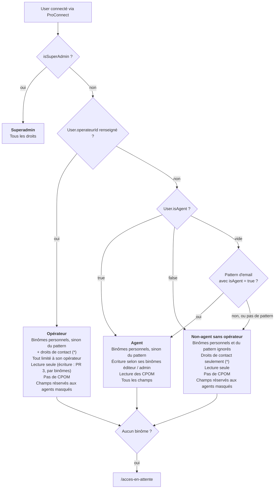

# Rôles et périmètres géographiques

Un utilisateur a des **binômes** `rôle × périmètre`. Ses droits sont l'union de ses binômes.

Quatre périmètres, et rien d'autre : **national, région, département, structure**. Pas de périmètre sur mesure : « 3 départements » = 3 binômes.

## Modèle

Un binôme est une ligne de `Grant` :

| Colonne                                        | Rôle                                               |
| ---------------------------------------------- | -------------------------------------------------- |
| `userId` ou `emailPatternId`                   | Le propriétaire : un user, ou un pattern d'email   |
| `role`                                         | `LECTEUR`, `EDITEUR`, `ADMIN`                      |
| `scope`                                        | `NATIONAL`, `REGION`, `DEPARTEMENT`, `STRUCTURE`   |
| `regionId`, `departementNumero`, `structureId` | La cible, selon le `scope`. Aucune pour `NATIONAL` |

Sur `User` :

- `isAgent` : `true` agent, `false` non-agent, vide = reprend le statut de son pattern d'email.
- `operateurId` : renseigné = user opérateur. Il l'emporte sur `isAgent` : un user rattaché à un opérateur n'est jamais agent.
- `isSuperAdmin` : tous les droits, hors binômes. Réservé à l'équipe Bhasile.

Sur `EmailPattern` : `isAgent`, faux par défaut. Les patterns de `fill-roles` sont des domaines d'agents (`isAgent = true`).

## Connexion et accès

- **Connexion** : tout compte ProConnect peut se connecter. Le user est créé ou mis à jour à chaque connexion, et rattaché au pattern d'email qui lui correspond, s'il en existe un.
- **Accès à l'application** : il faut au moins un binôme effectif, ou être superadmin. Sinon, le user est redirigé vers `/acces-en-attente` et les routes d'API ProConnect lui renvoient 401 : il ne voit aucune structure, aucun CPOM, aucune statistique.
- **Droits de base** : ceux du pattern d'email, s'il en matche un.
- **Droits spécifiques** : des binômes ajoutés à la main sur le user.

Quels binômes s'appliquent à un user :

- s'il a des binômes personnels, **eux seuls** ;
- sinon, ceux du pattern d'email qui lui correspond (droits de base) ;
- sinon, aucun.

## Agent, opérateur, contact

Le statut d'agent est toujours **affirmé**, jamais déduit d'un champ vide : un user dont on a oublié l'`operateurId` n'est pas agent.



(\*) Droits de contact : seulement si `CONTACT_ACCESS_ENABLED=true`.

Le pattern d'email ne porte pas encore d'opérateur : un pattern d'opérateur (`@coallia.org`) avec `isAgent = false` mène aujourd'hui à « Non-agent sans opérateur ». `EmailPattern.operateurId` viendra avec le premier pattern d'opérateur, et donnera alors la branche « Opérateur ».

- **Droits de contact** : un user non-agent qui figure comme contact (même email, sans tenir compte de la casse) dans la version affichée d'une structure reçoit un binôme `LECTEUR` × `STRUCTURE` sur cette structure. Ces binômes sont calculés à chaque session, jamais stockés : retirer le contact retire le droit. Ils s'ajoutent aux autres binômes. Ils sont désactivés tant que `CONTACT_ACCESS_ENABLED` ne vaut pas `true` (voir « Avant d'activer les contacts »).
- **Champs réservés aux agents** : pour un non-agent, la fiche et la liste des structures masquent notes, contrôles, évaluations, EIG, anomalies justifiées et CPOM (`hideAgentOnlyFields`).
- **Une seule source** : `isAgentUser` (`users/user.util.ts`) calcule le statut à partir de la base, la session le porte (`user.isAgent`), et le code le lit avec `isAgent(user)` (`lib/casl`).

## Droits appliqués aujourd'hui

`LECTEUR` < `EDITEUR` < `ADMIN`. Les binômes s'additionnent, aucun ne restreint : sur une structure, le rôle le plus fort parmi les binômes qui la couvrent s'applique.

- Admin AURA + lecteur Isère : admin partout en AURA, Isère comprise.
- Lecteur AURA + admin Isère : admin en Isère, lecteur dans le reste d'AURA.

| Qui                      | Lecture                                | Écriture                               |
| ------------------------ | -------------------------------------- | -------------------------------------- |
| User sans binôme         | Rien (page `/acces-en-attente`)        | Rien                                   |
| Binôme `LECTEUR`         | Les structures et CPOM de ce périmètre | Rien                                   |
| Binôme `EDITEUR`/`ADMIN` | Les structures et CPOM de ce périmètre | Les structures et CPOM de ce périmètre |
| Superadmin               | Tout                                   | Tout                                   |

Ce que couvre un binôme :

- **Structures** : national = toutes ; région ou département = celles dont le département de rattachement est couvert ; structure = celle-là.
- **CPOM** : national = tous ; région ou département = ceux dont au moins un département est couvert, plus les CPOM régionaux de la région concernée ; structure = ceux liés à cette structure. Un CPOM régional n'a pas de ligne `CpomDepartement` : il couvre tous les départements de sa région (`regionId`), que `getCpomDepartements` (`cpoms/cpom.util.ts`) en déduit pour la liste, la fiche et les rappels CPOM. Un binôme département donne donc aussi la main sur les CPOM régionaux de sa région. Les autres payloads (fiche structure, fichiers) gardent les lignes brutes, vides pour un CPOM régional.
- **Opérateurs** : un agent éditeur, quel que soit son niveau, modifie tous les opérateurs ; un user opérateur ne modifie rien, même son opérateur (lecture seule jusqu'à la PR 3). La lecture des opérateurs n'est pas filtrée.
- **User opérateur** : tout est en plus restreint aux structures et CPOM de son opérateur.

Où s'applique la lecture : liste, carte et fiche des structures, statistiques et cartographie (donc leurs exports, RMU compris : ceux des départements couverts), liste et fiche des CPOM. Une fiche hors périmètre renvoie une 404, et sans user la lecture est refusée. Exception : la sélection de structure du formulaire opérateur (mot de passe, sans session) reste non filtrée, via `getFullStructuresForOperateur`. Le tableau de bord reste filtré sur l'**écriture** : il sert à agir.

Une seule définition de « ce que couvre un binôme » (`getStructureConditions` / `getCpomConditions` dans `casl/rules.ts`) sert aux règles CASL de lecture et d'écriture. Les filtres Prisma en sont tirés par `accessibleBy` : `getReadableStructureWhere` (listes, carte, statistiques), `getReadableCpomWhere` (liste des CPOM) et `getUpdatableCpomWhere` (rappels CPOM du tableau de bord).

Limites actuelles :

- **`ADMIN` = `EDITEUR`** tant que la gestion des binômes (PR 2) n'existe pas.
- **Non filtré en lecture** : la fiche opérateur (et la liste de ses structures), les fichiers (`/api/files`, ouverts à toute session), les pages de transformation, la moyenne départementale d'activité, et les vues `reporting` / Metabase (hors application).
- **Users opérateurs** : les RMU des statistiques ne sont filtrés que par département, pas par opérateur. À fermer avec les statistiques en PR 3.
- **Niveau structure** : pas d'accès aux transformations du tableau de bord, qui restent contrôlées par département.

Règle à respecter dans `casl/rules.ts` : le code ne compare jamais les rôles entre eux. Tout droit donné à un rôle doit l'être aussi aux rôles supérieurs, sinon la hiérarchie casse.

## Historique

Les binômes ont remplacé les anciennes tables `Role` / `RoleDepartement` (PR #1694). Le one-off `20260929-migrate-roles-to-grants` a converti les données :

- pattern ou rôle manuel, mêmes binômes : `LECTEUR national` + `EDITEUR` sur sa zone, ou `EDITEUR national` pour NATIONAL ;
- un rôle qui couvrait une région entière a donné un binôme région, sinon un binôme par département.

Les anciennes tables et colonnes (`Role`, `RoleDepartement`, `User.roleId`, `EmailPattern.roleId`) sont supprimées. Le one-off n'est plus rejouable.

Deux changements visibles pour les agents sont arrivés avec les binômes :

- **CPOM** : un agent régional ou départemental ne modifie plus les CPOM hors de son périmètre. Avant, il les modifiait tous.
- **Brevo** : `PERIMETRE` envoie un libellé (« Bretagne », « National ») au lieu du nom de rôle, et `DEPARTEMENT` est vide pour un agent national.

Scripts : `fill-roles` remplace les binômes des patterns présents dans le CSV (le CSV fait foi), `brevo-push-users` lit les binômes.

## Choix et raisons

- **Pas de table `Perimetre`** : avec quatre niveaux fixes, la cible tient dans le binôme, et la hiérarchie admin se lit sur la géographie.
- **`scope` explicite** plutôt que déduit des colonnes vides : un binôme sans cible ne donne **rien**, jamais tout.
- **Région stockée comme région** : une structure qui arrive en AURA entre automatiquement dans les binômes AURA.
- **Droits de base portés par le pattern, jamais recopiés sur le user** : un changement de poste met les droits à jour tout seul.
- **Le manuel l'emporte sur le pattern**, comme l'ancien rôle manuel : un agent `@national.gouv.fr` rattaché à la Bretagne est lecteur national et éditeur Bretagne, rien de plus.
- **Une seule table `Grant`** pour les users et les patterns : mêmes colonnes des deux côtés.
- **Opérateur porté par le user, pas par le binôme** : un agent n'est jamais limité par opérateur, et un user opérateur appartient à un seul opérateur.
- **Pas d'enum `User.type`** : opérateur = `operateurId` renseigné, une seule source de vérité.
- **Suppressions** : supprimer une région, un département ou une structure supprime ses binômes (`Cascade`). Supprimer un opérateur qui a des users est refusé (`Restrict`).

## Points d'attention

- **CPOM chargé sans ses champs de périmètre** : la règle CPOM lit `departements`, `structures`, `granularity` et `regionId` (`cpomScopeSelect`). Un CPOM passé à CASL sans l'un d'eux ne lève pas d'erreur : la condition correspondante ne matche pas et l'accès est refusé en silence.
- **Pattern d'email d'opérateur** (`@coallia.org`) : à créer avec `isAgent = false`. Il ne doit viser qu'un domaine propre à l'opérateur, jamais un domaine public. Tant que `EmailPattern.operateurId` n'existe pas, un tel pattern ne donne aucun droit (non-agent sans opérateur).
- **Pas de contrainte en base sur `Grant`** : Prisma ne modélise pas les CHECK, et on ne veut pas de migration écrite à la main. Une ligne sans propriétaire ou sans cible est donc possible ; elle ne donne aucun droit. La cohérence est vérifiée par le service (PR 2).
- **Premier binôme personnel d'un agent** : il remplace tous ses droits de base. Il faut recopier ceux à garder, au minimum `LECTEUR national`.
- **Maisons mères et filiales** (`Operateur.parentId`) : non géré, à traiter plus tard.
- **Un user sur deux opérateurs** : cas exclu.

## Avant d'activer les contacts

`CONTACT_ACCESS_ENABLED=true` ouvre l'application à des non-agents. Avant de l'activer en prod, il faut fermer ce qui reste ouvert à toute session :

- **Fichiers** (`/api/files`) : lisibles par toute session.
- **Opérateurs** : fiche et liste non filtrées.
- **Transformations** : pages non filtrées en lecture.
- **Statistiques** : à fermer aux non-agents (le RMU suit le département).
- **Pages et menu** : pages réservées aux agents et menu des non-agents (PR de Benjamin, qui utilise `isAgent`).

## Mise en prod de `isAgent`

Le postdeploy lance une fois `20261027-mark-existing-agents` : tous les patterns existants et les users à binômes personnels passent agents. Il ne fait plus rien dès qu'un pattern est agent. Vérification : aucun user avec des binômes ne doit être non-agent.

```sql
SELECT count(*)
FROM "User" u
LEFT JOIN "EmailPattern" p ON p.id = u."emailPatternId"
WHERE u."operateurId" IS NULL
  AND COALESCE(u."isAgent", p."isAgent", false) = false
  AND (EXISTS (SELECT 1 FROM "Grant" g WHERE g."userId" = u.id)
    OR EXISTS (SELECT 1 FROM "Grant" g WHERE g."emailPatternId" = u."emailPatternId"));
```

La ligne du postdeploy est à retirer à la PR suivante.

## Reste à faire

1. **PR 2, administration des binômes** :
   - API de gestion, qui vérifie un seul propriétaire et une cible conforme au `scope` ;
   - hiérarchie admin héritée de la géographie : un admin ajoute ou révoque un binôme, admin compris, si la cible est **dans** son propre périmètre d'admin.
     - National : tout.
     - Région : sa région, ses départements, leurs structures. Ni le national, ni les autres régions.
     - Département : son département et ses structures.
     - Structure : cette structure.
     - Un admin opérateur ne gère que les users de son opérateur.
   - matrice ressource × action × rôle × agent/opérateur validée par le métier.
2. **PR 3, ouverture aux opérateurs** :
   - invitation d'un user opérateur par un admin ;
   - authentification des users opérateurs via ProConnect (adresses gmail) ;
   - cloisonnement : toutes les règles d'un user opérateur filtrées sur son `operateurId` ;
   - lecture des opérateurs filtrée ;
   - écriture des users opérateurs : aujourd'hui lecture seule ; à ouvrir par leurs binômes éditeur / admin, restreints à leur `operateurId`, selon la matrice validée par le métier ;
   - écriture des CPOM : aucune règle ne la donne aux users opérateurs, même `ADMIN`, qui reçoivent un 403 sur `POST /api/cpoms` et `PUT /api/cpoms/[id]`. À trancher : leur ouvrir les CPOM de leur opérateur ou confirmer le refus ;
   - champs réservés aux agents masqués : notes, justification d'anomalies, contrôles, évaluations, CPOM, finalisation de transformation ;
   - Metabase et statistiques fermés aux opérateurs.
